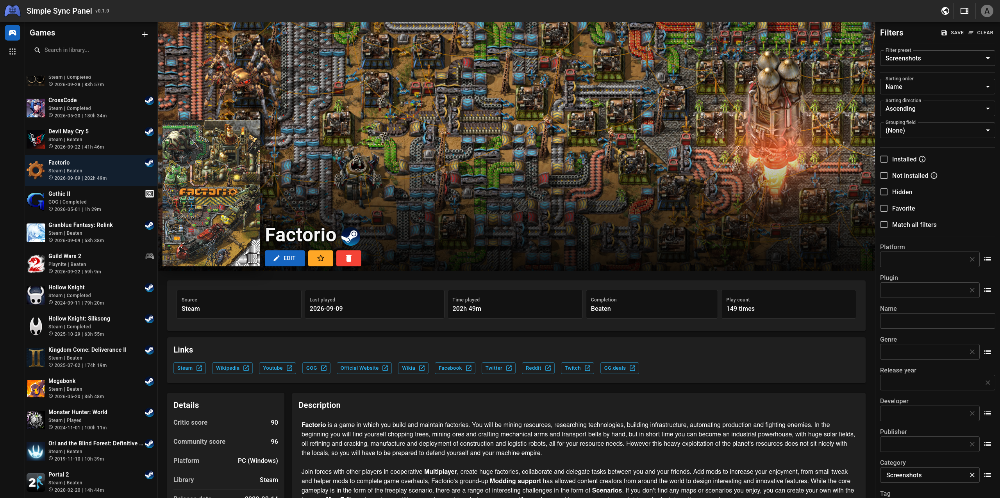
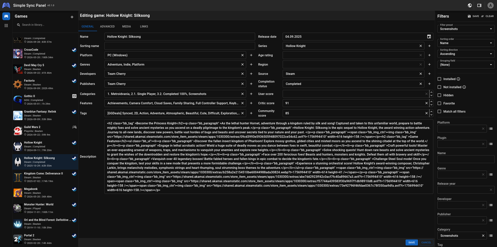
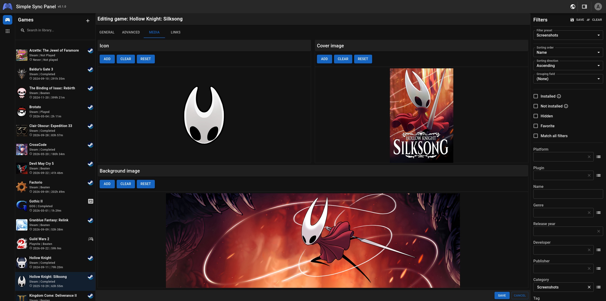
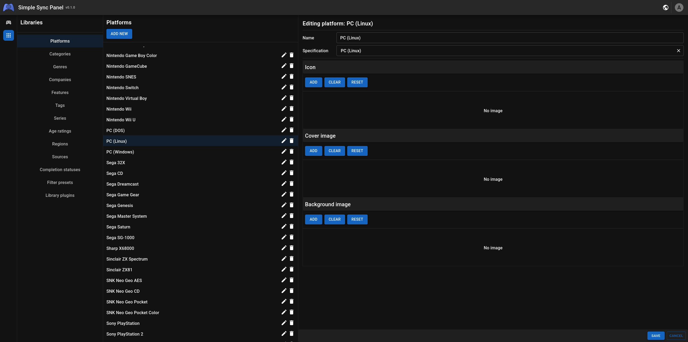

#  Simple Sync Panel

Management panel for the Simple Sync project. It allows you to remotely access and manage your Simple Sync Server.

The goal was to create an interface that's similar enough to the regular Playnite client. Most of the basic features
such as game, filter preset and library editing has been implemented, so you can manage your library remotely almost as
close in the native client.

## Examples

<table>
  <tr>
    <td align="center">
       
      Main view - game details
    </td>
    <td align="center">
       
      Game edit view - main tab
    </td>
  </tr>
  <tr>
    <td align="center">
       
      Game edit view - media tab
    </td>
    <td align="center">
       
      Library management view
    </td>
  </tr>
</table>

## Installation

Check [the main project repo](https://github.com/Yalgrin/simple-sync-project) for the instructions.

## Issues

If you encounter any issues, please report them in
the [main project repo](https://github.com/Yalgrin/simple-sync-project/issues).

## Future plans

Check [the main project repo](https://github.com/Yalgrin/simple-sync-project) for the plans going forward.

## Donate

If you like what I do, feel free to buy me a coffee.

